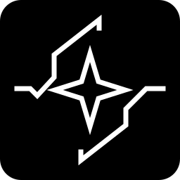
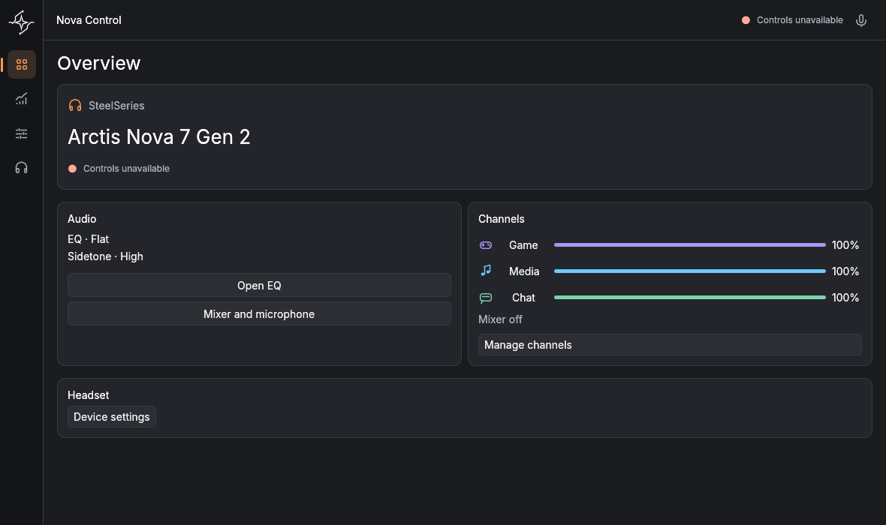

<p align="center">
  
</p>
<h1 align="center">Nova Control</h1>
<p align="center"><strong>Hardware headset controls and per-app audio mixing for Linux.</strong><br>Rust · SteelSeries Arctis · PipeWire</p>
<p align="center"><a href="#headset-support">Headset support</a> · <a href="#quick-start">Quick start</a> · <a href="#install-from-a-checkout">Install with Docker</a> · <a href="#hardware-eq">Presets</a> · <a href="README.uk.md">Українська</a></p>

## Headset support

| SteelSeries headset | USB dongle ID | Available in Nova Control |
| --- | --- | --- |
| **Arctis Nova 7 Gen 2** | `1038:227e` | **Hardware verified** · App controls for battery, Sidetone, EQ, microphone and ChatMix. |
| Arctis Nova 7X Gen 2 | `1038:229e` | Experimental battery and ChatMix probe in 0.3.9+. |
| Arctis Nova 7 Gen 1 | `1038:2202`, `1038:22a1` | Experimental battery and ChatMix probe in 0.3.10+. |
| Arctis Nova 7X Gen 1 | `1038:2206`, `1038:22a4`, `1038:22a5` | Experimental battery and ChatMix probe in 0.3.10+. |

Experimental probes are read-only terminal commands. [Probe instructions and test reports](docs/headsets.md)

On Nova 7 Gen 2, Overview shows connection, battery, active EQ, and quick actions. The microphone section in Mixer and header shortcut control the hardware Sidetone levels Off, Low, Medium and High. Nova Control reads the current value automatically and applies slider changes on release. Use **Save to headset** or `nova-control sidetone save` to commit the current device settings.



[Mixer and microphone screenshot](docs/screenshots/mixer.png)

## Quick start

Download the standalone executable from [GitHub Releases](https://github.com/hiddensudo/nova/releases) or the latest successful [Linux build](https://github.com/hiddensudo/nova/actions/workflows/linux.yml). On Linux, run:

```sh
chmod +x nova-control
./nova-control
```

The Debian 12 build targets Linux x86-64 and requires glibc 2.36+, a graphical session with OpenGL, and the system libpulse library (libpulse0 on Debian and Ubuntu). It runs without Rust, Python, or Docker installed. The mixer talks to PipeWire’s Pulse server directly. USB permissions may require the bundled udev rule.

### Install desktop integration

Download the Linux archive for your architecture and extract it. `BUILD.txt` lists the minimum glibc version for that particular build. Run the installer with Python 3.9 or later from the extracted folder.

```sh
python3 install.py
```

Search for **Nova Control** in your application menu. Run the same command from a newer archive to update, then reopen the app if an older copy is still running. The installer copies the executable to `~/.local/bin/nova-control` and adds a per-user desktop entry. You can move or delete the extracted folder after installation.

## Install from a checkout

With Docker running and Python 3.9 or later installed, open a terminal in this repository and run:

```sh
./install
```

The script builds with a temporary Docker builder, installs Nova for your user, and removes that builder and its build cache. For USB permissions, run `./install --udev`, then reconnect the dongle. For one-step-at-a-time help, copy the [installation prompt](docs/install-prompt.md) into ChatGPT or Claude.

## Build from source

Use Rust 1.95+, Python 3.11+, a C compiler and pkg-config. On Debian or Ubuntu, install `build-essential pkg-config libwayland-dev libxkbcommon-dev libegl1-mesa-dev libgl1-mesa-dev libx11-dev libpulse-dev`. Run the installer from the source directory to build and install.

```sh
python3 install.py
```

Repeat after extracting a newer source archive or updating your checkout with `git pull --ff-only`. Cargo reuses the release build cache. To build without installing, run `cargo build --release --locked`. For a CLI-only build, add `--no-default-features`.

The desktop app uses Wayland or X11 with OpenGL. If the local user lacks access to the dongle, follow the steps in the Ukrainian guide to install the udev rule. [Udev setup](README.uk.md#доступ-до-донгла)

## Command line

```sh
~/.local/bin/nova-control detect
~/.local/bin/nova-control sidetone get
~/.local/bin/nova-control sidetone set 1
```

Levels `0` through `3` match the four slider positions. If the USB interface is busy, close the other headset manager and try again.

## Build in Docker

```sh
docker build --target binary --output type=local,dest=dist .
./dist/nova-control
```

For release archives, checksums, and the same executable as a separate file, select `--target artifacts`. That target also runs the tests. `python3 scripts/package.py` produces the same layout from a local build. The [GitHub Actions workflow](.github/workflows/linux.yml) uploads the artifacts and publishes them on matching version tags.

`src/device/` holds the device protocol and USB transports. `src/ui/` holds the Engine, layout, slider and theme. `src/cli.rs` handles the terminal interface. Run `cargo test --locked` and `python3 -m unittest discover -s tests` for checks without opening a window.

[Verified Sidetone protocol](https://github.com/Sapd/HeadsetControl/pull/560) · [Linux USB interface roles](https://lists.openwall.net/linux-kernel/2026/08/03/2425)

## Hardware EQ

The **EQ** page reads the active hardware curve and includes four local presets. You can also load a community snapshot of SteelSeries GG Sonar profiles:

```sh
python3 scripts/fetch-gg-presets.py
```

In **EQ**, choose **Reload library**, then search by name or use Favorites. You can also copy your own Nova or Sonar JSON files into `~/.config/nova-control/presets/` (or `$XDG_CONFIG_HOME/nova-control/presets/`). The pinned [community catalog](https://github.com/loteran/Arctis-Sound-Manager/blob/84545e49839e44137ce06b6e10df807ad0ad2440/presets_manifest.json) contains 385 profiles. Nova imports supported playback EQ curves. Microphone profiles and curves with unsupported filters are visible but disabled. Sonar effects such as ClearCast AI, spatial audio, and compression are separate from the headset’s playback EQ.

Use `nova-control eq list|get|select|export|import` from the terminal. Drag filters on the graph or enter precise frequency, gain and Q values. A/B applies the previous or current curve for comparison. Use **Save to headset** or `nova-control eq save` to commit the current device settings. [Hardware EQ format](https://github.com/loteran/Arctis-Sound-Manager/issues/146)

## PipeWire mixer

Application rows show locally installed program icons when available, with a letter fallback for unknown applications.

Enable the mixer to create Game, Media, Chat, and any custom sinks you configure. Assign active applications with the channel menu or by dragging them to a channel. Levels, mute state, order, colors and routes are stored in the XDG configuration. The enabled state is saved. The installer registers a background mixer at desktop sign-in. It restores the saved settings when the headset becomes available and keeps running after the window closes. Choose **Disable mixer** to stop routing immediately and keep it off across sign-ins. `nova-control mixer run` remains available for manual foreground sessions. Requires PipeWire’s Pulse server.

Enable **Physical ChatMix dial** to balance any two channels, including Game and Media. Other channels keep their own levels. CLI commands include `nova-control mixer chatmix Game Media`, `nova-control mixer chatmix off` and `nova-control mixer dial`.

The microphone section in Mixer controls mic gain. The Device panel controls the inactivity timeout and mute LED brightness. These are also available under `nova-control settings`.

## Desktop integration

Only one GUI instance runs per desktop session. Launching it again restores and focuses the existing window. Closing with X exits the window process. Use the separate header button to minimize the window to the system tray.

The monochrome Impulse icon is installed with the desktop entry and embedded in the window and tray fallback. In the sidebar, its transparent vector paths are drawn directly at the current display scale. Editable SVG sources and size-adjusted PNGs live in `packaging/linux/icons/`. The optional authoring command `python3 scripts/render_icons.py` regenerates PNGs with rsvg-convert; normal builds use the checked-in files.

Nova Control uses the StatusNotifierItem system tray where available. The tray menu can switch between the four Sidetone levels and reopen the last visible panel. The interface defaults to English. The Device panel lets you switch to Ukrainian and toggle desktop notification types independently. Notifications require the Linux notify-send command.

Use **Assign global shortcut** in Device settings to register a Sidetone cycle shortcut. This requires a desktop backend for the XDG Global Shortcuts portal. The desktop may ask for approval or let you choose a key combination.

The mixer CLI also supports **channel list**, **channel add NAME**, **channel rename NAME NEW**, and **channel remove NAME**. Existing Game, Media and Chat routes carry forward when updating from 0.2.0.

## Navigation and mixer layout

Mouse buttons 4 and 5 navigate backward and forward through visited panels. The Mixer includes Sidetone and mic gain, full-width channel rows, and the application list below them. Drag a channel by its grip to reorder it, or use Move up / Move down in its menu. All channel orders, including built-in channels, are saved.

Hardware ChatMix samples are collected on a dedicated thread with a 25 ms target interval. The UI receives changed samples immediately and animates the position. Headset battery and charging status are queried every 350 ms, with a filling battery indicator while charging.

See the [hardware Sidetone investigation](docs/sidetone-research.md) for the distinction between the headset monitor and the processed microphone stream.
